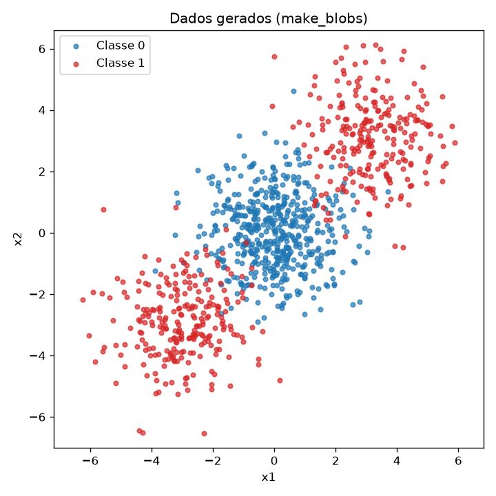
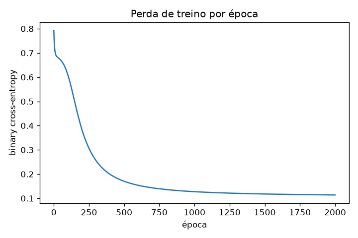
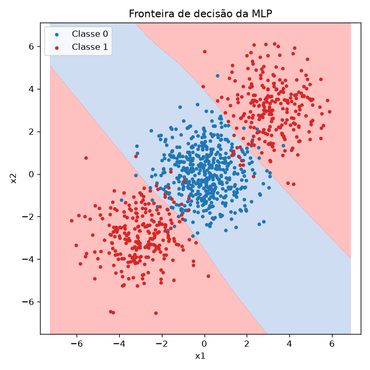
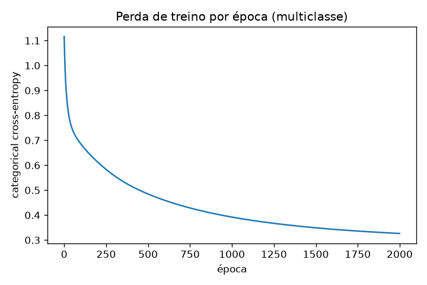
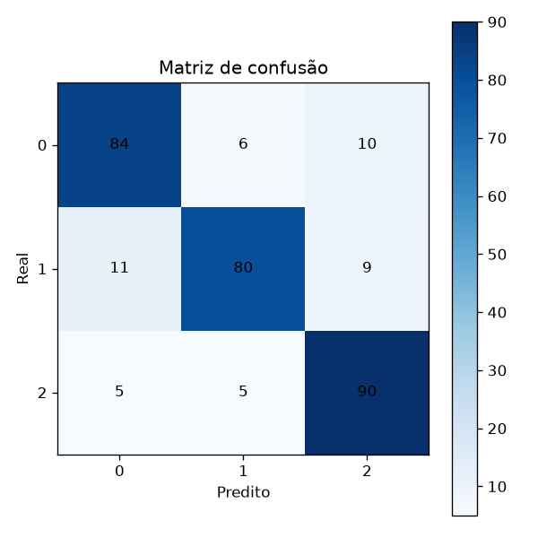
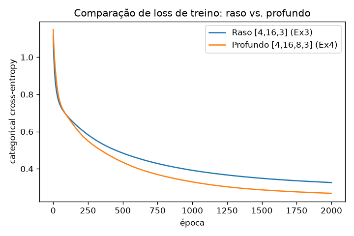

# Atividade: MLP

!!! info "Uso de Inteligência Artificial"
    Utilizei o Claude como assistente de orientação ao longo deste exercício: ele explicou os conceitos envolvidos, revisou minha lógica e me ajudou a organizar o código e a estrutura do relatório. Toda a implementação, execução dos experimentos e interpretação dos resultados foi feita por mim.

## **Ex 1: Um passo de retropropagação, na mão**

Aplicação da retropropagação para entender os parâmetros de uma MLP.

!!! info "MLP Utilizada"
    Rede: 2 entradas, 1 camada oculta com 2 neurônios, 1 neurônio de saída. Ativação tanh nas duas     camadas. Loss é o erro quadrático médio sobre uma única amostra (N=1), então $L = (y-\hat y)^2$.

Valores usados: 
$\mathbf{x}=[0{,}5,\,-0{,}2]$,

$y=1{,}0$, 

$\mathbf{W}^{(1)}=\begin{bmatrix}0{,}3 & -0{,}1\\0{,}2 & 0{,}4\end{bmatrix}$, 

$\mathbf{b}^{(1)}=[0{,}1,\,-0{,}2]$, 

$\mathbf{W}^{(2)}=[0{,}5,\,-0{,}3]$, $b^{(2)}=0{,}2$, $\eta=0{,}3$.

### A) Passagem direta

Exercício de ponto de partida para conseguir compreender o que a rede prediz antes de qualquer ajuste e o quanto esse palpite está errado. Ponto inicial para entender depois, exercício B, o quanto cada peso contribui no erro visto neste exercício.

A camada oculta tem 2 neurônios, cada um fazendo sua própria soma ponderada das 2 entradas (x1, x2) mais um bias. É por isso que W(1) é uma tabela 2x2, uma linha de pesos por neurônio, e não um único número.

**1. Pré-ativações da camada oculta:** $\mathbf{z}^{(1)} = \mathbf{W}^{(1)}\mathbf{x} + \mathbf{b}^{(1)}$

$z^{(1)}_1 = 0{,}3(0{,}5) + (-0{,}1)(-0{,}2) + 0{,}1 = \mathbf{0{,}2700}$

$z^{(1)}_2 = 0{,}2(0{,}5) + 0{,}4(-0{,}2) + (-0{,}2) = \mathbf{-0{,}1800}$

**2. Ativações da camada oculta:** $\mathbf{h}^{(1)} = \tanh(\mathbf{z}^{(1)})$

"Entortando" z com a tanh pra um resultado no intervalo (-1, 1). Sem isso, empilhar camadas de soma ponderada geraria uma única soma ponderada, e a rede nunca aprenderia nada além de uma reta.

$h^{(1)}_1 = \tanh(0{,}2700) = \mathbf{0{,}2636}$

$h^{(1)}_2 = \tanh(-0{,}1800) = \mathbf{-0{,}1781}$

**3. Pré-ativação de saída:** $u^{(2)} = \mathbf{W}^{(2)}\mathbf{h}^{(1)} + b^{(2)}$

O neurônio de saída faz a mesma conta da camada oculta, só que agora as "entradas" dele são os h que acabaram de sair da camada oculta, não mais o x original.

$u^{(2)} = 0{,}5(0{,}2636) + (-0{,}3)(-0{,}1781) + 0{,}2 = 0{,}1318+0{,}0534+0{,}2000 = \mathbf{0{,}3852}$

**4. Saída e perda:**

$\hat y = \tanh(0{,}3852) = \mathbf{0{,}3672}$

A perda mede o quão longe o palpite da rede ($\hat y$) ficou do valor certo ($y=1{,}0$). Usando erro quadrático:

$L = (y-\hat y)^2 = (1{,}0000-0{,}3672)^2 = \mathbf{0{,}4004}$

### B) Passagem reversa

Agora que sei o quanto a rede errou ($L=0{,}4004$), é possível entender o quanto os parâmetros influenciam no erro. Isso é visto a partir da derivada parcial de $L$ em relação a cada parâmetro (o gradiente). Como a rede é uma cadeia de cálculos ($x \to z^{(1)} \to h^{(1)} \to u^{(2)} \to \hat y \to L$), a regra da cadeia diz que, pra achar o efeito de um parâmetro lá no início da cadeia (como $\mathbf{W}^{(1)}$), é preciso multiplicar os efeitos de cada elo pelo caminho. Dessa forma, a análise parte do cálculo pelo "fim", onde o erro já é conhecido e é possível depois "repassar a culpa" para os parâmetros que vem antes (reaproveitando a conta já feita em vez de recalcular tudo do zero pra cada parâmetro).

!!! info "Pensando nas derivadas"
    Cada derivada local usada segue a lógica fixa que depende do tipo de operação: quando a variável é multiplicada por um peso (como x dentro de z, ou h dentro de u), a derivada local é o valor que estava sendo multiplicado por ela. Quando a variável é somada direto, como o bias, a derivada local é sempre 1, dado que não existe multiplicador ali, então mexer no bias afeta a soma na mesma proporção. E quando a variável passa pela tanh, a derivada local é a inclinação da tanh naquele ponto, $1-h^2$, que mede o quanto aquele neurônio ainda tem espaço pra mudar antes de saturar perto de -1 ou +1.

**1. $\partial L/\partial u^{(2)}$ (usando a derivada da tanh):**

Ponto de partida da cadeia é o sinal de erro na saída, antes de ele ser repartido entre os pesos.

$\dfrac{\partial L}{\partial \hat y} = 2(\hat y-y) = 2(0{,}3672-1{,}0000) = \mathbf{-1{,}2655}$

$\dfrac{\partial \hat y}{\partial u^{(2)}} = 1-\hat y^2 = 1-(0{,}3672)^2 = \mathbf{0{,}8651}$

$\dfrac{\partial L}{\partial u^{(2)}} = (-1{,}2655)(0{,}8651) = \mathbf{-1{,}0948}$

**2. Camada de saída:** $\partial L/\partial \mathbf{W}^{(2)}$ e $\partial L/\partial b^{(2)}$

Como $u^{(2)}=\mathbf{W}^{(2)}\mathbf{h}^{(1)}+b^{(2)}$, o quanto cada peso de saída contribui pro erro depende de quanto da ativação do neurônio oculto correspondente "passou" por ele, por isso é multiplicado o sinal de erro pelo $h^{(1)}$ de cada neurônio ($\partial u^{(2)}/\partial W^{(2)}_j = h^{(1)}_j$; já o bias entra direto, $\partial u^{(2)}/\partial b^{(2)}=1$).

$\dfrac{\partial L}{\partial W^{(2)}_1} = \dfrac{\partial L}{\partial u^{(2)}}\cdot h^{(1)}_1 = (-1{,}0948)(0{,}2636) = \mathbf{-0{,}2886}$

$\dfrac{\partial L}{\partial W^{(2)}_2} = (-1{,}0948)(-0{,}1781) = \mathbf{0{,}1950}$

$\dfrac{\partial L}{\partial b^{(2)}} = \mathbf{-1{,}0948}$

**3. Propagando de volta:** $\partial L/\partial \mathbf{h}^{(1)}$ e $\partial L/\partial \mathbf{z}^{(1)}$

Agora o erro precisa continuar "voltando", até a camada oculta. Primeiro, o sinal de erro foi repartido entre os dois neurônios ocultos, proporcional ao peso que cada um tem na saída ($\partial u^{(2)}/\partial h^{(1)}_j = W^{(2)}_j$). Depois, o sinal é ajustado pela sensibilidade da tanh naquele ponto específico ($1-(h^{(1)}_j)^2$): um neurônio já "saturado" perto de -1 ou +1 tem pouco espaço pra mudar, então recebe menos "culpa".

$\dfrac{\partial L}{\partial h^{(1)}_1} = (-1{,}0948)(0{,}5) = \mathbf{-0{,}5474}$

$\dfrac{\partial L}{\partial h^{(1)}_2} = (-1{,}0948)(-0{,}3) = \mathbf{0{,}3284}$

$\dfrac{\partial L}{\partial z^{(1)}_1} = (-0{,}5474)(1-0{,}2636^2) = (-0{,}5474)(0{,}9305) = \mathbf{-0{,}5094}$

$\dfrac{\partial L}{\partial z^{(1)}_2} = (0{,}3284)(1-(-0{,}1781)^2) = (0{,}3284)(0{,}9683) = \mathbf{0{,}3180}$

**4. Camada oculta:** $\partial L/\partial \mathbf{W}^{(1)}$ e $\partial L/\partial \mathbf{b}^{(1)}$

Com o sinal de erro já na camada oculta, o processo de "culpa" entre pesos é feito da mesma forma que foi feito na camada de saída, em que foi multiplicado pelo valor que passou por aquele peso.
As entradas originais $x$ ($\partial z^{(1)}_j/\partial W^{(1)}_{j,i}=x_i$; o bias de novo entra direto, $\partial z^{(1)}_j/\partial b^{(1)}_j=1$).

$\dfrac{\partial L}{\partial W^{(1)}_{1,1}} = (-0{,}5094)(0{,}5) = \mathbf{-0{,}2547}$

$\dfrac{\partial L}{\partial W^{(1)}_{1,2}} = (-0{,}5094)(-0{,}2) = \mathbf{0{,}1019}$

$\dfrac{\partial L}{\partial W^{(1)}_{2,1}} = (0{,}3180)(0{,}5) = \mathbf{0{,}1590}$

$\dfrac{\partial L}{\partial W^{(1)}_{2,2}} = (0{,}3180)(-0{,}2) = \mathbf{-0{,}0636}$

$\dfrac{\partial L}{\partial b^{(1)}_1} = \mathbf{-0{,}5094}$, $\quad \dfrac{\partial L}{\partial b^{(1)}_2} = \mathbf{0{,}3180}$

### C) Atualização dos parâmetros

Agora que é possível saber pra que lado e o quanto cada um dos parâmetros empurra a loss (o gradiente), é hora de ajustar eles de verdade. O gradiente descendente dá um passo na direção oposta ao gradiente — por isso o sinal de menos na fórmula abaixo — porque o gradiente aponta pra direção que aumenta a loss, e queremos o contrário. O tamanho do passo é controlado por $\eta$: $\eta$ grande demais arrisca "pular" o ponto bom; $\eta$ pequeno demais deixa o ajuste lento. Aqui foi usado $\eta=0{,}3$ em todos os parâmetros, de uma vez.

$$p \leftarrow p - \eta \cdot \dfrac{\partial L}{\partial p}$$

| Parâmetro | Valor antigo | Gradiente | Valor novo |
|---|---|---|---|
| $W^{(2)}_1$ | 0,5000 | -0,2886 | **0,5866** |
| $W^{(2)}_2$ | -0,3000 | 0,1950 | **-0,3585** |
| $b^{(2)}$ | 0,2000 | -1,0948 | **0,5284** |
| $W^{(1)}_{1,1}$ | 0,3000 | -0,2547 | **0,3764** |
| $W^{(1)}_{1,2}$ | -0,1000 | 0,1019 | **-0,1306** |
| $W^{(1)}_{2,1}$ | 0,2000 | 0,1590 | **0,1523** |
| $W^{(1)}_{2,2}$ | 0,4000 | -0,0636 | **0,4191** |
| $b^{(1)}_1$ | 0,1000 | -0,5094 | **0,2528** |
| $b^{(1)}_2$ | -0,2000 | 0,3180 | **-0,2954** |

Olhando o tamanho (módulo) de cada gradiente na tabela, dá pra ver quais parâmetros mais pesam na loss nesse ponto específico: $b^{(2)}$ se destaca com $-1{,}0948$, quase o dobro do segundo maior ($W^{(2)}_1$, $-0{,}2886$) (lembrando que o bias tem derivada local sempre 1, então recebe o sinal de erro "puro", sem ser encolhido pelas multiplicações da cadeia). Já os pesos da camada oculta, como $W^{(1)}_{2,2}$ ($-0{,}0636$), são os menos influentes, porque o sinal de erro chega neles diluído por várias multiplicações no caminho de volta. Essa leitura vale só pra esse exemplo e nesse instante do treino, que muda a cada novo passo.

A loss deve diminuir numa segunda passagem direta. O gradiente descendente sempre dá um passo que reduz a loss localmente, desde que $\eta$ não seja grande demais a ponto de passar do ponto ideal, usando o $\eta=0{,}3$ é moderado o suficiente pra isso valer de fato: refazendo o forward pass inteiro com os valores novos, $\hat y$ sai de $0{,}3672$ pra $0{,}7118$ que é bem mais perto do alvo $y=1{,}0$, e a loss cai de $0{,}4004$ pra $\mathbf{0{,}0834}$.

## **Ex 2: Classificação binária que uma reta não resolve**

### A) Geração dos dados

Foram gerados 1000 pontos em três blobs gaussianos (`make_blobs`, `random_state=42`, `cluster_std=1.2`): um centrado em (0,0) com 500 pontos, e dois nas pontas da diagonal, em (3,3) e (-3,-3), com 250 pontos cada. O blob central vira a **Classe 0**, e os dois blobs das pontas juntos viram a **Classe 1**.

Essa "divisão" da Classe 1 é feita de forma proposital para gerar um caso em que uma única reta não consegue separar as classes, necessitando de fronteira curva (que é obtida através de MLP com camada oculta).

*Figura 1: distribuição dos 1000 pontos gerados. A Classe 0 (azul) ocupa o centro; a Classe 1 (vermelho) ocupa as duas pontas opostas da diagonal.*

### B) Baseline linear (regressão logística)

Como baseline, foi treinada uma regressão logística (`sklearn.linear_model.LogisticRegression`) nos mesmos dados, com split 80/20 estratificado (`random_state=42`). A regressão logística aprende exatamente uma reta de fronteira entre as classes que é o modelo linear mais direto possível para esse problema.

- **Acurácia no teste: 0,475 (47,5%)**. 

Pior que um chute aleatório (50%, já que as classes estão balanceadas). Os coeficientes aprendidos ficaram praticamente nulos, confirmando que o modelo não encontrou nenhuma reta capaz de separar as classes: a simetria da Classe 1 em torno da Classe 0 faz qualquer fronteira linear cortar as duas classes quase ao meio. Isso confirma numericamente o que já tinha sido visto na Figura 1.

### C) MLP do zero

Para conseguir delimitar a fronteira esperada para exercício e reaproveitar a função para os demais exercício, implementei uma MLP genérica (classe `MLP`, parâmetro `layer_sizes` definindo o número de neurônios por camada), com ativação tanh nas camadas ocultas, sigmoid na saída e binary cross-entropy como perda. A passagem direta, a perda, a passagem reversa, cálculo do gradiente (regra da cadeia, igual ao Exercício 1) e atualização dos pesos, tudo implementado manualmente. Os parâmetros utilizados foram `[2, 8, 1]` (2 entradas, 8 neurônios na camada oculta, 1 saída), com `lr=0.1` e 2000 épocas de treino.

**Acurácia no teste: 0,915 (91,5%)**! contra os 47,5% do baseline linear.

*Figura 2: evolução da perda de treino ao longo das 2000 épocas, caindo de forma suave de ~0,79 para ~0,12.*

*Figura 3: fronteira de decisão aprendida pela MLP. A região azul (prevista como Classe 0) forma uma faixa diagonal ao redor do cluster central, exatamente o tipo de fronteira curva que uma reta não consegue reproduzir.*

### D) Análise

Analisando de modo geral ambos os resultados obtidos, baseline linear e aplicação da MLP:

- Baseline linear (item B): acurácia de 47,5% (pior que chute aleatório)
- MLP (item C): acurácia de 91,5%.

Essa grande discrepância tem explicação geometrica direta - como já foi anteriormente abordada nas demais seções - em que a classe 1 foi construída propositalmente como duas regiões opostas, envolvendo a classe 0 (Figura 1). Essa característica dos pontos inviabiliza uma boa regressão logística que, por sua vez, só consegure representar uma única reta de fronteira, o que sempre vai deixar metade da classe 1 do lado errado (dado que estão em lados opostos). Essa condição que foi exposta na acurácia do baseline em que o modelo não encontrou nenhuma reta útil.

A MLP resolve isso porque cada neurônio da camada oculta aprende sua própria reta de corte (sua própria combinação linear das entradas, seguida da ativação tanh), e a camada de saída combina essas várias retas numa única decisão. Com 8 neurônios ocultos, a rede tem 8 "retas" para compor que combinadas consegue fechar uma região que não é reta (como o baseline), como a faixa diagonal visível na Figura 3, que envolve a Classe 0 e deixa as duas metades da Classe 1 do lado de fora. Isso é o que uma única reta jamais conseguiria fazer, e é a razão pela qual esse dataset foi desenhado assim: para expor o limite de um classificador linear e mostrar o ganho de ter uma camada oculta não-linear em MLPs.

## **Ex 3: MLP multiclasse (a mesma rede)**

### A) Geração dos dados

Diferentemente do exercício anterior, para esta aplicação da MLP gerei 1500 amostras com 4 features (`make_classification`, `n_informative=4`, sem features redundantes ou repetidas), distribuídas em 3 classes. Cada classe é formada por 2 sub-grupos (`n_clusters_per_class=2`), totalizando 6 grupos no espaço de 4 dimensões, com separação entre eles (`class_sep=1.0`). Split 80/20 estratificado (`random_state=42`), resultando em 1200 amostras de treino e 300 de teste, com as classes balanceadas em ambos os conjuntos (~400/400/400 e 100/100/100). Esse aumento de classe e feature faz com que aqui os dados não são visualizáveis diretamente (4D), então não há uma figura de dispersão pra visualizar os dados.

### B) Adaptação para multiclasse

A saída passa de 1 neurônio (sigmoid) para 3 (softmax, um por classe), e a perda passa de binary cross-entropy para entropia cruzada categórica. A derivação de $\partial L/\partial u$ para o par softmax + entropia cruzada segue o mesmo princípio do Ex2 (sigmoid + BCE):

**Derivação de ∂L/∂u (softmax + entropia cruzada):**

$$\frac{\partial L}{\partial u_i} = \sum_k \frac{\partial L}{\partial p_k}\cdot\frac{\partial p_k}{\partial u_i} = \sum_k \left(-\frac{y_k}{p_k}\right) p_k(\delta_{ki}-p_i) = p_i - y_i$$

O resultado tem a mesma forma de $\hat y - y$ do Ex2, agora vetorial: $\mathbf{p}-\mathbf{y}$. Por isso, o `delta` inicial do backward do Ex2 (`(saída - alvo) / n`) é reaproveitado sem alteração — a única mudança real de código é na ativação de saída (sigmoid → softmax) e na forma de calcular a perda, ambos tratados como parâmetros (`output_activation`) em vez de estrutura fixa.

### C) Treino e avaliação

Arquitetura `[4, 16, 3]` (4 entradas, 16 neurônios na camada oculta, 3 saídas), `lr=0.1`, 2000 épocas.

- **Acurácia: 84,7%**, dentro da faixa esperada pelo enunciado (~83%–86%).

*Figura 4: evolução da perda de treino por entropia cruzada categórica ao longo das 2000 épocas, caindo de forma suave de ~1,12 para ~0,33.*

*Figura 5: matriz de confusão no conjunto de teste (300 amostras, 100 por classe).*

### D) Análise

- **Par mais confundido:** olhando a Figura 5 na matriz de confusão, o par Classe 0 e Classe 1 concentra o maior número de erros (11 + 6 = 17), à frente de 0 e 2 (15) e 1 e 2 (14).

Essa confusão tem origem na estrutura dos dados: cada classe não é um grupo único, mas sim 2 sub-grupos, totalizando 6 sub-grupos para apenas 3 rótulos, espalhados em apenas 4 dimensões com separação moderada. Com 6 sub-grupos competindo por espaço em 4D, é esperado que, por acaso, algum sub-grupo da Classe 0 acabe posicionado mais perto de um sub-grupo da Classe 1 do que de outro sub-grupo da própria Classe 0, possivelmente é esse tipo de sobreposição que gera os erros concentrados nesse par.

- **Comparação com o baseline linear:** a regressão logística multiclasse atingiu 66,3% de acurácia, bem abaixo dos 84,7% da MLP. 

O motivo é o mesmo do Exercício 2, agora em maior escala: com 6 sub-grupos para separar usando apenas fronteiras lineares (uma por par de classes), a regressão logística não consegue isolar sub-grupos que estão "misturados" com os de outra classe. A camada oculta da MLP permite compor fronteiras não lineares, sendo o mesmo tipo de ganho visto na fronteira em faixa do Ex2 (Figura 3), aqui generalizado para 4 dimensões e 3 classes, conseguindo isolar regiões mais complexas do espaço do que uma única reta por par de classes jamais conseguiria.

## **Ex 4: Analisando se mais camadas ocultas auxiliam**

### A) Rede mais profunda

Para analisar se uma segunda camada oculta ajuda, estendi a rede do Ex3 para 2 camadas ocultas ( `[4, 16, 8, 3]`, contra `[4, 16, 3]` do Ex3, sendo 2 camadas ocultas - 16 e depois 8 neurônios), mantendo os mesmos hiperparâmetros (`lr=0.1`, 2000 épocas, mesmos dados e seed), pra garantir uma analise controlada e isolar o efeito apenas da mudança de profundidade.

- **Acurácia no teste: 87,7%**, contra 84,7% da rede rasa do Ex3.

### B) Comparação controlada

*Figura 6: perda de treino por época, rede rasa (Ex3) vs. rede profunda (Ex4), usando comparação na seed 42.*

| Rede | Camadas ocultas | Nº de parâmetros | Loss final (treino) | Acurácia (teste) |
|---|---|---|---|---|
| Rasa (Ex3) — `[4,16,3]` | 1 | 131 | 0,3245 | 0,840 |
| Profunda (Ex4) — `[4,16,8,3]` | 2 | 243 | 0,2753 | 0,866 |

*Valores de loss e acurácia são a média de 3 seeds (42, 7, 123), para garantir que a comparação reflete as arquiteturas e não sorte de uma rodada específica.*

Nas 3 seeds testadas, a rede profunda venceu, mesmo que seja por uma diferença pequena (+2,6 pontos percentuais de acurácia em média, e loss de treino menor). Esse resultado difere um pouco do que era esperado, em que uma camada única já deveria ter sido suficiente na teoria, mas na próxima seção será mais aprofundada essa análise.

### C) Análise

A rede profunda venceu a rasa nas 3 seeds (acurácia média 0,866 vs. 0,840; loss de treino 0,2753 vs. 0,3245), o que não é exatamente o que a teoria sugere como mais provável (que uma camada só já bastaria, e a segunda nem precisaria ajudar), mas foi o que aconteceu, então é isso que reportei.

**Por que a vantagem foi pequena:** os dados do Ex3 têm 6 grupos (2 por classe) espalhados em 4 dimensões, com separação moderada, não sendo um problema simples, mas também não é absurdamente complexo. Uma única camada oculta com 16 neurônios já dá conta de desenhar uma fronteira boa o suficiente pra acertar 84%. A rede profunda quase dobrou o número de parâmetros (131 → 243) pra ganhar só ~2,6 pontos percentuais a mais de acurácia. Ou seja: o ganho existe, mas é pequeno perto do tanto a mais de rede que foi preciso usar.

**O que a segunda camada faz de diferente:** a primeira camada aprende um conjunto de "cortes" simples nos dados. A segunda camada pega esses cortes e combina eles, criando fronteiras um pouco mais flexíveis do que a rede rasa consegue sozinha. Isso tem um custo: mais parâmetros pra treinar com o mesmo número de épocas e o mesmo lr, e mais chance de dar overfitting (principalmente com esses dados mockados), sem garantia nenhuma de que essa capacidade extra vai realmente ser bem aproveitada no treino.

**A loss de treino e a acurácia de teste contam a mesma história?** Sim: a rede profunda teve loss de treino menor e acurácia de teste maior, nas 3 seeds. Se tivesse dado overfitting, a loss de treino teria caído mas a acurácia de teste teria piorado ou ficado igual, que não foi o caso aqui. Isso é um sinal de que a capacidade extra ajudou de verdade, só que pouco.

**Quando valeria a pena ter mais camadas:** quando os dados têm uma estrutura "em camadas" de verdade, como é visto em imagens, onde a rede primeiro aprende a reconhecer bordas, depois combina bordas pra reconhecer formas, depois combina formas pra reconhecer objetos (como é feito no YOLO, por exemplo). Nesses casos, cada camada extra realmente desbloqueia algo que uma camada só não consegue fazer, nem com muito mais neurônios. Com só 6 grupos moderadamente separados em 4 dimensões, não é esse o caso aqui, por isso a vantagem da profundidade apareceu, mas foi pequena.

É comum esperar que uma segunda camada ajude justamente por dar à rede mais capacidade de identificar padrões e isso costuma ser verdade quando o problema realmente tem uma estrutura complexa pra aprender. Só que em problemas simples, sem essa complexidade estrutural (como esse, com só 6 grupos moderadamente separados em 4 dimensões), o esperado não era esse, dado que a capacidade a mais tende a ser neutra na melhor das hipóteses, ou a atrapalhar, porque a rede tem parâmetros de sobra pra "decorar" o treino em vez de aprender algo generalizável,de onde viria o risco de overfitting comentado, sem ganho real. Por isso o resultado aqui chama atenção que mesmo com esse risco a favor da rede rasa, a profunda ainda levou vantagem nas 3 seeds, um indício de que, nesse caso específico, a capacidade extra foi usada de forma genuína (como já vimos: loss de treino e acurácia de teste melhoraram juntas), e não só pra decorar o treino.

## Resumo dos resultados

| Exercício | Configuração | Métrica | Valor |
|---|---|---|---|
| Ex1 | 1 passo de retropropagação (η=0,3) | Loss antes → depois do passo | 0,4004 → 0,0834 |
| Ex2 | Baseline linear (regressão logística) | Acurácia (teste) | 0,475 |
| Ex2 | MLP `[2,8,1]`, lr=0,1, 2000 épocas | Acurácia (teste) | 0,915 |
| Ex3 | Baseline linear (regressão logística multiclasse) | Acurácia (teste) | 0,663 |
| Ex3 | MLP `[4,16,3]`, lr=0,1, 2000 épocas | Acurácia (teste) | 0,847 |
| Ex4 | MLP rasa `[4,16,3]` (média de 3 seeds) | Acurácia (teste) | 0,840 |
| Ex4 | MLP profunda `[4,16,8,3]` (média de 3 seeds) | Acurácia (teste) | 0,866 |

Resumo geral: o Ex1 mostrou, na mão, como um único passo de gradiente já reduz a loss de forma mensurável. Os Ex2 e Ex3 mostraram o mesmo padrão em dois cenários diferentes (binário e multiclasse) que, em ambos, o baseline linear ficou bem abaixo do esperado (47,5% e 66,3%), enquanto a MLP com só 1 camada oculta resolveu o problema com folga (91,5% e 84,7%), porque consegue combinar várias retas numa fronteira não linear, algo que uma regressão logística nunca consegue fazer sozinha. Já o Ex4 mostrou que o ganho de ter uma camada oculta não é a mesma coisa que o ganho de ter mais camadas ocultas: adicionar uma segunda camada trouxe uma melhora real, mas pequena (84,0% → 86,6%), porque o problema do Ex3 não tinha complexidade estrutural suficiente pra justificar o quase dobro de parâmetros usados. No geral, o salto grande de desempenho em toda a atividade veio de sair de "zero camadas ocultas" pra "uma camada oculta" e não de empilhar mais camadas em cima.