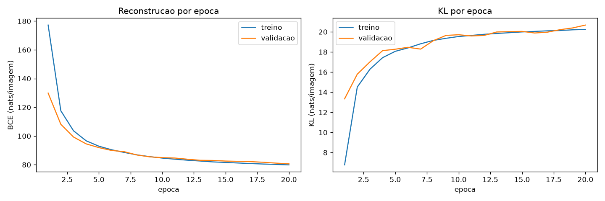
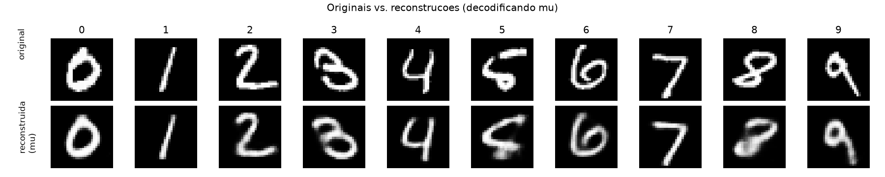
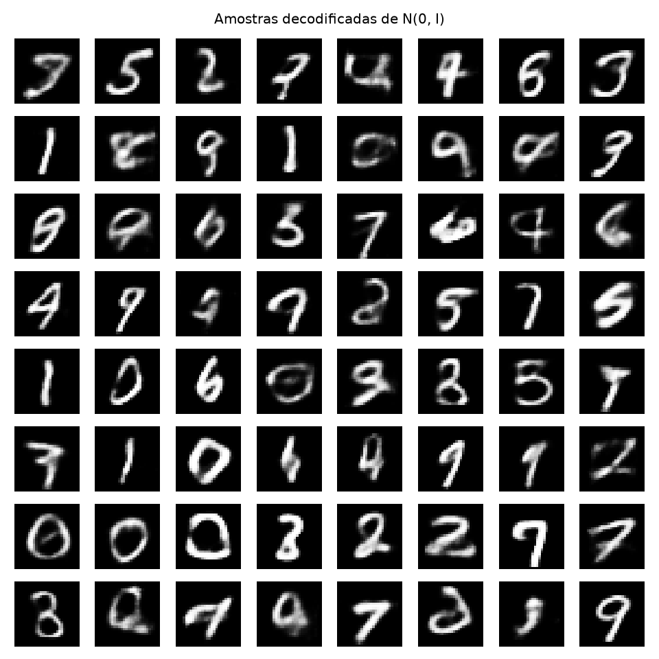
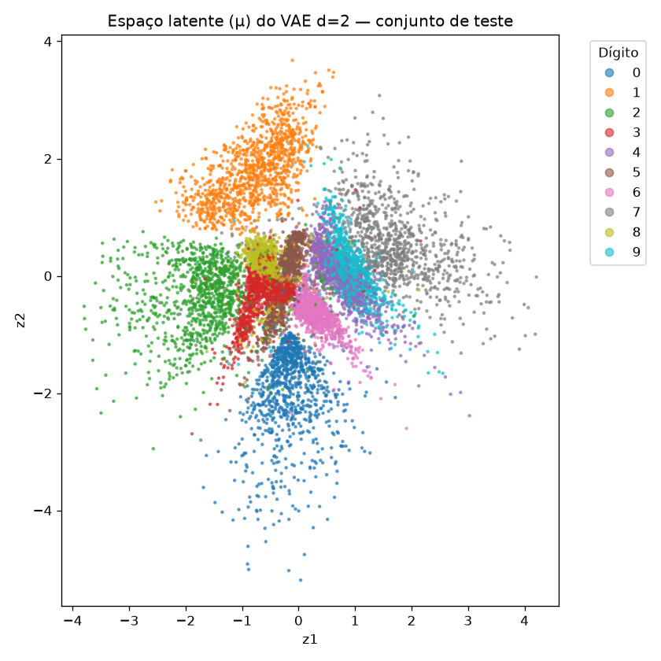
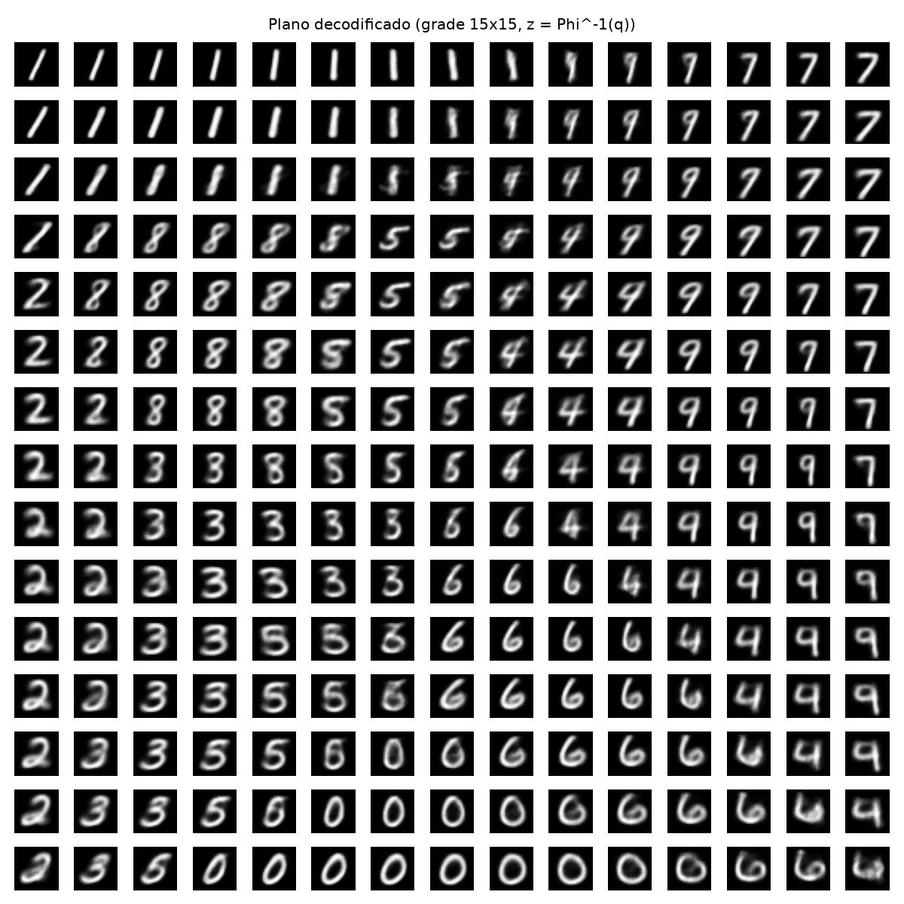
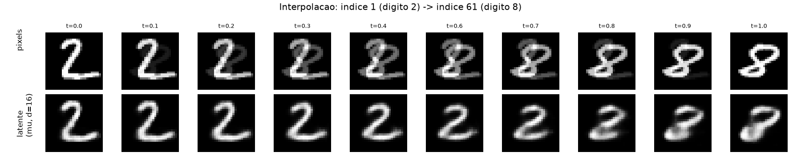

# Atividade: VAE

!!! info "Uso de Inteligência Artificial"
    Utilizei o Claude como assistente de orientação ao longo deste exercício: ele explicou os conceitos envolvidos (autoencoders, o truque da reparametrização, a divergência KL), revisou minha lógica e me ajudou a organizar o código e a estrutura do relatório. Toda a implementação, execução dos experimentos e interpretação dos resultados foi feita por mim.

## **Ex 1: Um VAE no MNIST**

### A) Dados

Usei o MNIST com pixels normalizados em [0,1] e achatados em vetores de 784 (28×28). O conjunto oficial de treino (60.000 imagens) foi dividido em 50.000 para treino e 10.000 para validação, com gerador de semente 42. As 10.000 imagens oficiais de teste formam o conjunto de teste, usado apenas para os números finais.

### B) Modelo e perda

Segundo as recomedações do enunciado, a arquitetura do modelo foi desenhada segundo tal referência:

**Encoder:** 784 → 512 → 256 (ReLU), com duas cabeças lineares de 256 → 16 (d=16): uma para a média ($\mu$) e outra para o log da variância ($\log\sigma^2$) da distribuição latente de cada imagem.

**Decoder:** 16 → 256 → 512 → 784, com ReLU nas camadas ocultas e sigmoid na saída (garante pixels em [0,1]).

**Reparametrização:** $z = \mu + \sigma \cdot \varepsilon$, com $\varepsilon \sim \mathcal{N}(0,1)$ sorteado externamente, para permitir backpropagation através do passo de amostragem.

**Perda:** soma da reconstrução (binary cross-entropy somada sobre os 784 pixels) com a KL em forma fechada entre $\mathcal{N}(\mu,\sigma^2)$ e o prior $\mathcal{N}(0,I)$ (com $\beta=1$), ambas com média sobre o batch:

$$D_{KL} = -\frac{1}{2}\sum_{j=1}^{16}\left(1 + \log\sigma_j^2 - \mu_j^2 - \sigma_j^2\right)$$

### C) Treino

Adam (lr=$10^{-3}$), batches de 128, 20 épocas. Registrados os dois termos da perda (reconstrução e KL) separadamente, por época, em treino e validação.

**Resultados no teste:** reconstrução = 79,98 nats, KL = 20,69 nats, ELBO negativo = 100,67 nats — bem próximo da referência do exercício esperada (~81 nats de reconstrução, ~20 de KL).

A KL de validação saiu de 13,34 nats (época 1) para 20,67 nats (época 20) — subindo ao longo de todo o treino, mesmo com a perda total caindo (discutido na análise, item 1).

*Figura 1: reconstrução e KL por época, treino e validação. A reconstrução cai de forma suave e consistente; a KL sobe rapidamente nas primeiras épocas antes de estabilizar.*

### D) Reconstruções e amostras

*Figura 2: a primeira imagem de teste de cada dígito (linha de cima) e sua reconstrução decodificando $\mu$, sem amostragem (linha de baixo). As reconstruções são bem fiéis às originais.*

*Figura 3: grade 8×8 de amostras decodificadas de $\mathcal{N}(0,I)$ (seed 0). Visivelmente mais borradas que a Figura 2, com alguns dígitos ambíguos entre duas formas.*

### E) Análise

**1. Por que a KL sobe nas primeiras épocas enquanto a perda total cai?** 

No início do treino, os pesos são próximos de aleatórios de modo que a reconstrução está péssima (177 nats na época 1) e domina a perda total, enquanto a KL já começa baixa (6,78 nats), já que um encoder não treinado tende a produzir $\mu$ perto de 0 e variância perto de 1, que é próximo do prior. Para melhorar a reconstrução, o encoder precisa afastar cada $\mu$ do centro (para diferenciar os dígitos entre si) e reduzir a variância (para ficar mais preciso), mas isso é exatamente o que aumenta a KL. Como a melhora na reconstrução é muito maior, em magnitude, que a piora na KL nas primeiras épocas, a soma total ainda cai, mesmo com a KL subindo.

**2. Por que a Figura 3 parece pior que a Figura 2?** 

Essa discrepância advém de duas condições. A primeira é dada visto que o `z` da Figura 2 é o $\mu$ aprendido para uma imagem real específica, determinado a partir de um ponto que o decoder viu muitas vezes durante o treino. Enquanto, por sua vez, o `z` da Figura 3 é sorteado direto do prior, sem relação com nenhuma imagem real, podendo cair em regiões pouco visitadas durante o treino. Segundo, mesmo em regiões conhecidas do espaço latente, o decoder tende a produzir saídas borradas. Isso acontece porque, durante o treino, uma mesma imagem nunca é associada a um único ponto fixo, a cada passagem pela rede, um `z` levemente diferente é sorteado ao redor do `mu` daquela imagem (por causa da reparametrização). Ou seja, o decoder aprende a reconstruir vizinhanças inteiras de pontos como se fossem aquela imagem, não um ponto exato. Como a KL empurra as manchinhas de todos os dígitos para perto do mesmo centro, as manchinhas de dígitos parecidos (como 4 e 9) acabam próximas, e suas bordas podem se sobrepor. Num ponto de sobreposição dessas, o decoder viu, durante o treino, tanto exemplos de um dígito quanto do outro, e a melhor resposta para minimizar o erro médio ali não é apostar com confiança num dos dois, e sim gerar algo no meio-termo entre eles, borrado. É por isso que a Figura 3 tem mais ambiguidade, ela amostra justamente essas regiões "de fronteira" com mais frequência que a Figura 2, que usa pontos bem definidos (as médias de imagens reais).

**3. Por que decodificar $\mu$ na Figura 2, em vez de um $z$ amostrado?** 

O $\mu$ é o "melhor palpite" do encoder para aquela imagem específica sendo o centro exato da distribuição aprendida. Amostrar um $z$ adicionaria ruído aleatório desnecessário à visualização, tornando a reconstrução menos fiel ao que o modelo realmente aprendeu sobre aquela imagem. O ruído da amostragem é necessário durante o treino (para fazer a KL funcionar), mas não na hora de mostrar o que o modelo aprendeu.

## **Ex 2: Um espaço latente que dá para ver**

### A) VAE 2-D

Para este outro exercício, treinei um segundo VAE, idêntico ao do Exercício 1 (dados, seed, $\beta=1$, mesmos 20 épocas com Adam lr=$10^{-3}$), mudando apenas a dimensão latente de 16 para 2.

| Modelo | Reconstrução (teste) | KL (teste) |
|---|---|---|
| $d=16$ (Ex1) | 79,98 nats | 20,69 nats |
| $d=2$ (Ex2) | 134,12 nats | 6,75 nats |

A reconstrução piora bastante com $d=2$ (134,12 vs. 79,98 nats) o que já era esperado, já que só 2 números têm muito menos espaço pra guardar informação distintiva de cada imagem do que 16. A KL cai (6,75 vs. 20,69) pelo motivo oposto: com menos dimensões, há menos "liberdade" pra a distribuição se afastar do prior.

### B) Teste codificado

*Figura 4: médias $\mu$ das 10.000 imagens de teste, coloridas por dígito.*

### C) Plano decodificado

*Figura 5: grade 15×15 de pontos decodificados, com $z = \Phi^{-1}(q)$, $q$ igualmente espaçado em [0,05; 0,95].*

Os valores de $q$ são igualmente espaçados em probabilidade, não em valor de $z$; como $\Phi^{-1}$ converte cada probabilidade no ponto correspondente da normal, e a normal concentra mais massa perto do centro, essa conversão produz pontos mais próximos entre si perto do centro e mais espaçados nas pontas (essa condição garante que cada célula da grade representa a mesma fatia de probabilidade do prior, em vez de superamostrar o centro ou desperdiçar células nas regiões raras).

### D) Interpolação

Escolhidas duas imagens de teste de dígitos diferentes: índice 1 (dígito 2) e índice 61 (dígito 8).

*Figura 6: interpolação entre os índices 1 (dígito 2) e 61 (dígito 8), $t$ de 0 a 1. Linha de cima: interpolação linear nos pixels. Linha de baixo: interpolação entre $\mu$ no modelo $d=16$ do Ex1, decodificando o resultado.*

### E) Análise

**1. Quais dígitos se sobrepõem na Figura 4?** 

A partir da Figura 4 é possível observar que os digítos 1 e 0 (dado que são os dígitos com traços mais distintos dos demais) ficam isolados em regiões separadas, enquanto a região central do gráfico concentra uma mistura de vários dígitos (3, 4, 5, 6, 8 e 9). 

Na Figura 5, essa mesma mistura aparece como uma transição suave e contínua entre formas. Essa conclusão pode ser visto por exemplo na sequência de células que passa de "8" para "5" para "4" para "9" em que cada imagem intermediária ainda parece um dígito, só que embaçado/ambíguo entre os dois vizinhos. Essa transição mostra que essas classes realmente ocupam regiões vizinhas e parcialmente sobrepostas do espaço latente, não só coincidência de cor no gráfico.

**2. O que os dois números por imagem obrigam o modelo a descartar?** 

Com só 2 números pra descrever cada imagem, o modelo não tem "espaço" pra separar todos os detalhes que diferenciam um traço de outro (espessura, inclinação, tamanho de cada característica, etc.), então ele é forçado a reter só as características mais grosseiras de forma (traço mais curvo ou mais reto, com ou sem laço superior) e descartar os detalhes finos que distinguiriam, por exemplo, um "5" de um "3" ou de um "8". A Figura 5 é a evidência direta disso: dígitos com traço parecido (3, 5, 6, 8, 9) ficam espremidos em regiões vizinhas, se misturando uns nos outros em vez de formarem regiões bem separadas, nesse espaço de 2 dimensões não tem "lugar" pra todos eles ficarem isolados.

**3. Compare as duas linhas da Figura 6.** 

A linha de cima (interpolação em pixels) produz uma espécie de transição ajustando a exposição dos números: as duas imagens originais vão se misturando e se sobrepondo, sem formar algo que pareça um dígito único e coerente no meio do caminho, parecendo só uma mistura e diferença de brilho entre dois traços diferentes. 

Já a linha de baixo (interpolação no espaço latente) passa por formas que continuam parecendo dígitos reais e formados em todos os passos (mesmo no centro e na transição, ainda é aparente algum dígito). Isso vem dado que ela está andando dentro do mapa organizado (no espaço latente) que o encoder/decoder aprenderam, onde qualquer ponto corresponde a algo que o decoder sabe desenhar como um traço plausível, em vez de só somar pixels brutos de duas imagens diferentes.

## Resumo dos resultados

| Item | Valor |
|---|---|
| Ex1 Reconstrução / KL / ELBO negativo no teste ($d=16$) | 79,98 / 20,69 / 100,67 nats |
| Ex1 KL de validação (1ª época → última época) | 13,34 → 20,67 nats |
| Ex2 Reconstrução / KL no teste ($d=2$) | 134,12 / 6,75 nats |
| Ex2 Índices de teste interpolados | 1 (dígito 2) e 61 (dígito 8) |